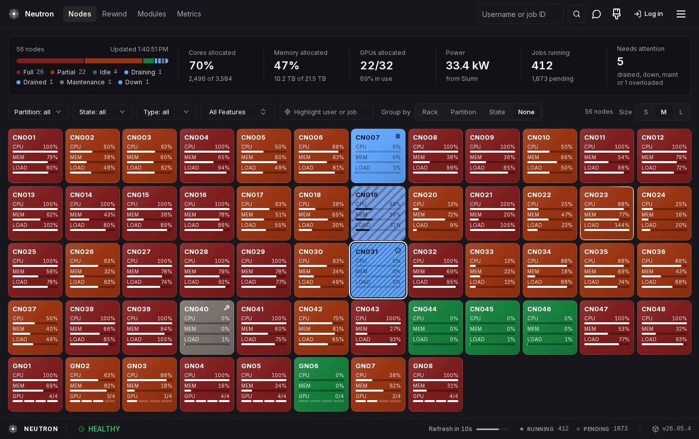

# Slurm Node Dashboard

[](https://www.gnu.org/licenses/gpl-3.0)
[](https://nodejs.org/)
[](https://nextjs.org/)

> A Next.js dashboard for operating Slurm clusters, with a configurable AI assistant built for HPC workflows.

Slurm Node Dashboard combines a live node view with optional historical analytics, GPU reporting, software modules, and a configurable Slurm assistant that can answer questions, call cluster tools, and be managed from the admin UI.



## Highlights

- Live cluster view with CPU/GPU node status, filtering, rack/group layouts, and 15 second refresh polling
- Optional pages for software modules, cluster rewind, node history and job metrics, which turn on when what they need is configured
- GPU analytics from Prometheus/DCGM recording rules, including job-level utilization views
- AI assistant with streaming chat, built-in Slurm workflow tools, documentation search, and structured tool result cards
- Admin-managed assistant configuration with YAML overrides, custom tools, restricted topics, and prompt preview/testing
- Admin dashboard for partitions, reservations, QoS, plugins, hierarchy data, and LLM assistant settings

## Requirements

- Node.js 20.9.0 or newer
- npm
- Access to a Slurm REST API (`slurmrestd`)
- Optional: PostgreSQL 13+ for Rewind, node history, GPU history and job metrics (see [Features](#features))
- Optional: Prometheus/DCGM metrics for GPU utilization features
- Optional: OpenAI-compatible API credentials for the assistant

Node 20 LTS and Node 22 both satisfy the current engine requirement.

## Quick Start

```bash
git clone https://github.com/thediymaker/slurm-node-dashboard.git
cd slurm-node-dashboard
npm install
```

Create a `.env.local` with the minimum local settings:

```env
NEXT_PUBLIC_BASE_URL=http://localhost:3020
BETTER_AUTH_SECRET=replace-with-a-long-random-string
ADMIN_USERNAME=admin
ADMIN_PASSWORD=change-me

CLUSTER_NAME=My Cluster
SLURM_SERVER=slurmrestd.example.edu
SLURM_SERVER_PORT=6820
SLURM_PROTOCOL=http
SLURM_API_ACCOUNT=dashboard
SLURM_API_TOKEN=replace-with-your-token
```

Then start the app:

```bash
npm run dev
```

Open `http://localhost:3020`. The dashboard uses the newest API version your slurmrestd serves; set `SLURM_API_VERSION` (for example `v0.0.42`) to pin one.

Settings are read when the server starts, so changing one needs a restart, not a rebuild. `infra/.env.production` lists them all.

## Features

Features turn on when what they need is configured; set a feature's flag to `false` to turn it off. **Admin → Plugins** shows what's on and why.

| Feature | Needs | Database |
|---|---|---|
| Nodes, jobs, partitions, reservations, QoS, admin | slurmrestd | No |
| Modules | `public/modules.json` or `MODULES_FILE` | No |
| Node charts | `PROMETHEUS_URL` | No |
| GPU utilization | Prometheus with DCGM metrics, `NEXT_PUBLIC_ENABLE_GPU_UTILIZATION=true` | No |
| AI assistant | `NEXT_PUBLIC_ENABLE_OPENAI_PLUGIN=true` and a model endpoint | No |
| Rewind | Hourly snapshots the dashboard saves | Yes |
| Node history | Drain and down periods the dashboard records | Yes |
| GPU history | GPU utilization | Yes |
| Job metrics | [slurm-history-ingestor](https://github.com/thediymaker/slurm-history-ingestor) writing to the same database | Yes |

For the database features, set `DATABASE_URL` to a PostgreSQL database the dashboard's user can create tables in. The dashboard creates its tables on startup and collects in the background; with several instances on one database, one of them collects.

## Docker

```bash
docker build -f infra/Dockerfile -t slurm-node-dashboard .
docker run -p 3000:3000 --env-file .env slurm-node-dashboard
```

Docker's `--env-file` keeps quotes as part of the value, so write `CLUSTER_NAME=Sol`, not `CLUSTER_NAME="Sol"` as in `infra/.env.production`.

Images built from `main` are published as `ghcr.io/thediymaker/slurm-node-dashboard:main`, and releases as `:<version>` and `:latest`. To serve under a sub-path, build your own image with `--build-arg NEXT_PUBLIC_BASE_PATH=...`.

## Upgrading

Upgrading from 2.x? See [UPGRADING.md](UPGRADING.md) for what changed and what you can remove.

### Serving under a sub-path

To serve the dashboard at a path such as `https://example.edu/slurm/cluster1` (for example, several clusters behind one reverse proxy), set `NEXT_PUBLIC_BASE_PATH=/slurm/cluster1` when building. With Docker, pass it as a build arg. The proxy must forward the path unchanged, e.g. nginx `location /slurm/cluster1 { proxy_pass http://localhost:3020; }` with no trailing slash on `proxy_pass`. If you run `next start` instead of the standalone server, set the variable at runtime too. Login cookies are scoped to the sub-path, so dashboards on the same host keep separate sessions.

## Documentation

For full deployment, feature flag, AI assistant, GPU metrics, and historical data setup details, see [slurmdash.com](https://slurmdash.com).

The job history ingestor lives in [thediymaker/slurm-history-ingestor](https://github.com/thediymaker/slurm-history-ingestor).

## Contributing

Pull requests are welcome. Keep changes focused, run linting for touched areas, and include any relevant setup or behavior notes in the PR.

## License

This project is licensed under the GNU General Public License v3.0. See [LICENSE.md](LICENSE.md) for details.

## Support

- Documentation: [slurmdash.com](https://slurmdash.com)
- Issues: [GitHub Issues](https://github.com/thediymaker/slurm-node-dashboard/issues)
- Contact: Johnathan Lee - [john.lee@thediymaker.com](mailto:john.lee@thediymaker.com)

---

<p align="center">
  Made with ❤️ for HPC
</p>
